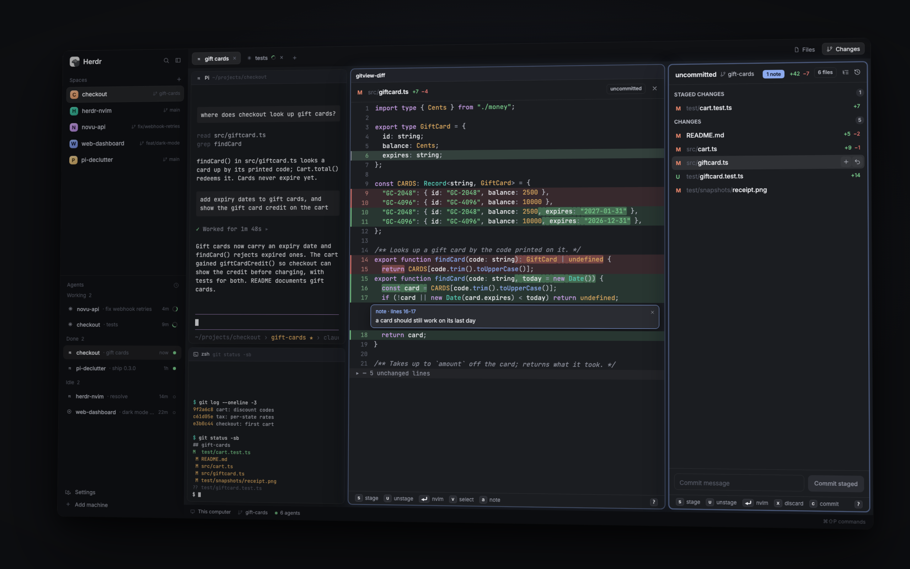

# gitview

gitview takes the place of Herdr's Changes panel. Press **Changes** in the
tab bar (or `cmd-shift-g`) and the right panel lists the shown space's
changed files the way gitview does: merge conflicts, staged changes and
changes, flat or as a folder tree, with stage `+`, unstage `−` and discard
`↺` buttons on the row under the pointer, on folders and on whole sections.
Click a file and its diff opens in a full-height pane just left of the
panel, drawn by gitview's own engine (syntax colors, red/green tints in the
app's theme, word emphasis, folded context). Enter opens nvim at the line
(herdr-nvim's nvim when it's installed). Drag over lines and press `a` to
write a review note; `p` sends the notes to any agent, placed in its input
or submitted, without the clipboard. `l` shows the history and each
commit's files, `n` the notes. `cmd-g` opens the same in a tab of its own.
Spaces on other machines work the same way.

## What you see

- **The panel** (the layout's `changes` block in the right column; 300 px
  when herdr-nvim is installed, resizable 280–900 px), drawn like the stock
  Changes panel: `background`, 1 px `border` (`accent` while it has the
  keyboard), 10 px corners, 13 px text. Top to bottom:
  - a 42 px header: `uncommitted` (or `vs <base>`) in semibold, a 12 px
    branch icon and the branch in 12 px `muted` (it gives way first), an
    `N notes` pill (`accent` on `accent_foreground`, 10.5 px, 5 px corners;
    a click opens the notes), a bordered `N files` pill, a braille spinner in
    `dim` while loading; from 340 px wide two 22 px icon buttons: tree/flat
    and history;
  - the list, 6 px padding above and below:
    - section headers, 28 px: the title in 11 px semibold uppercase `muted`
      and a count chip (`raised`, 8 px corners);
    - file rows, 28 px, 6 px from the sides, 7 px corners: the status letter
      in a 14 px column (11 px semibold: M `blocked`, A/U `ansi2`, D `ansi1`,
      R `ansi4`, ! `ansi1`), the folder in `dim` and the name in
      `foreground` (the folder shrinks first, then the name, both with "…"),
      `+adds` `ansi2` and `−dels` `ansi1` in 11 px. Hover: `hover`; selected:
      `selected` (`hover` while the panel doesn't have the keyboard);
    - on the hovered or selected row the counts give way to 22 px icon
      buttons (14 px Lucide icons in `muted`, `foreground` on `raised` under
      the pointer, with tooltips): changes `+` `↺`, conflicts `+`, staged `−`;
      a hovered section header shows the same for all its files;
    - tree mode: folder rows (12 px chevron in `dim`, 14 px folder icon in
      `muted`, the name, the file count in `dim`), a folder holding just one
      folder folded into it (`src/app`), 16 px indent per level;
    - a 6 px scroll thumb (`border`, `input` under the pointer) when the list
      is longer than the panel;
  - the commit row (changes view, worktree scope): a 32 px input with 8 px
    corners (border `accent` while typing) and a 32 px button, `solid` when
    there's a message: "Commit staged", or "Commit all" when the last status
    had nothing staged ("Committing…" meanwhile);
  - a 28 px footer: the view's most useful keys as keycaps, as many as fit
    (a 16 px box on `raised` with a `border` and 4 px corners, the key in
    the mono font at 10.5 px, ⏎ ↑ ← in the UI font; then its label in 11 px
    `dim`: `[s] stage [u] unstage [⏎] nvim [x] discard …`), and always a `?`
    keycap at the right edge that opens the keys card; a message in
    `blocked` replaces the keycaps for 5 s.
- **History** (`l`): a header with ← and "History", the branch (or `since
  <base>`) and an `all` / `branch` pill; 44 px rows: the subject and up to
  two refs (`accent` on `raised`), under it `<short sha> · <when> ·
  <author>` in 11 px `dim`. **A commit's files**: ← `<short sha>`, the
  subject, `N files`; its files as in the list (flat or tree), no buttons.
- **Notes** (`n`): ← "Notes", the repo, a count and a send button; 44 px
  rows: `folder/name:lines` (lines in `accent`) over the note's first line
  in `muted`, a × on the hovered or selected row.
- **The diff pane** (a mod pane, full height at the tab's right edge, just
  left of the panel, `view_width_percent` (50 %) of the tab; opened on the
  first file click): a 42 px header (the status letter, the folder in `dim`
  and the name in semibold, `+a −d`, a bordered scope tag: `staged`,
  `uncommitted`, `vs <base>` or `commit <sha>`, the spinner, a 22 px ×);
  the diff in 18 px rows in the terminal font at 12 px exactly as gitview's
  TUI draws it (a `▌` marker and line numbers in `dim`, syntax colors from
  gitview's dark or light set by the theme's background, folds `▸ ⋯ N
  unchanged lines` on `raised`), tints in the theme: inserts `ansi2` at 15 %,
  deletes `ansi1` at 15 %, changed words at 36 %. Selected lines are
  `selection`; span colors too dim for what's behind them (One Dark's
  comments on a Catppuccin insert tint) are lifted toward `foreground` until
  they reach a 3.5 contrast; the cursor line has a 2 px left border (`accent` while the
  pane has the keyboard, else `dim`). Note cards sit under their last line:
  44 px in, 8 px corners, `accent` border on `raised`, `note · lines 4-5` in
  11 px `accent` with an 18 px ×, the text in 12 px. The composer opens under
  the selection: a 104 px card on `surface` with "new note · lines a-b · enter
  saves · esc cancels" and a 52 px text area. The same 28 px footer of
  keycaps (`[⏎] save the note [esc] cancel` while writing one).
  **Preview** (markdown `.md .markdown .mdx`, images `.png .jpg .jpeg .gif
  .webp .bmp .ico`, `.svg`, `.html`): the header gets a `Diff | Preview`
  segmented toggle (a 1 px `border`, the shown side on `raised`; under
  420 px wide two icons, Lucide `diff` and `eye`); markdown renders in the
  UI font at 13 px, selectable and scrolling; an image fills the pane
  (contain), and a changed one shows before | after side by side (stacked
  under 560 px), each under an 11 px `dim` caption (`before · index`,
  `after · worktree`); a deleted file shows its old version with a
  `deleted` tag.
  With nothing selected: "No file selected / Click a file in the gitview
  list." centered in `dim`.
- **cmd-g's tab** "gitview": the diff pane on the left, the list on the right
  (29 %), both framed by the app like any pane.
- **Send notes**: a 460 px modal dialog on `popover`, "Send N notes to…",
  one 30 px row per agent (status dot, name, status, space / tab, address),
  this space's first.
- **Confirm**: the app's own `confirm` dialog ("Discard changes?").
- **Keys card** (`?`): a 500 px dialog on `popover`: the mod's name in
  15 px semibold, `esc` and `?` keycaps; then every key grouped by view
  (the shown one first, its title in `accent`, the others' in `muted`):
  22 px rows of keycaps (96 px column) and the label in `muted`; it
  scrolls when long.

## How it behaves

- The panel follows the shown space: the focused terminal's folder, else the
  space's (focusing gitview's own diff pane keeps the repo). cmd-g's list
  keeps the repo it was opened for. Local repos refresh on a folder watch
  and every 10 s; a space on another machine every 4 s while the panel shows.
- **List keys** (once it has the keyboard: a click anywhere in it, `pane.go`,
  cmd-shift-g): `j`/`k` or arrows move and the diff follows; `enter` or a
  double-click opens nvim (on a folder: folds it); `h`/`←` folds or goes to
  the parent folder, `→` unfolds; `s` stage, `u` unstage, `x` discard
  (confirm first) the row, folder or file; `t` flat ↔ tree; `w` uncommitted
  ↔ vs base; `l` history; `n` notes; `p` send notes; `c` the commit message
  (enter commits, esc leaves it); `g`/`G` first/last; `r` refresh. Chords
  with cmd, ctrl or alt are left to the app.
- **History**: `j`/`k`, `enter` (or a click) lists the commit's files and
  shows the first one's diff; `w` switches between the branch's own commits
  (`merge-base..HEAD`, the start in `vs base`) and all; `esc`/`h` go back up.
- **Notes**: `enter` (or a double-click) shows the note's file in the diff
  pane with the cursor on the note, on the side it was written on (staged or
  not); `d` deletes; `p` sends; `esc`/`n` back.
- **Diff pane keys**: `j`/`k`, arrows, page up/down, `g`/`G`, the wheel and a
  click move the cursor; `v` starts or ends a selection, a mouse drag selects
  (shift-click extends); `a` writes a note on the selection (enter saves, esc
  cancels; only on staged or unstaged changes, as in the TUI: not on a
  commit's or the branch's diff; a note keeps its side, and its card shows
  only on that side's diff); `enter` or a double-click opens nvim at the cursor's line (on a
  fold: unfolds it, as a click does); `s`/`u`/`x` stage, unstage or discard
  the shown file; the list, which refreshes, then has the pane show where
  it went (staged), or the file now where it was, with none left "No file
  selected"; `J`/`K`
  the next/previous file in the list's order (the list follows); `p` sends;
  `esc` clears the selection; `m` Diff or Preview; `?` the keys card; ×
  closes the pane (the next click opens it).
- **Keys card**: `?` (or the footer's `?`) opens it; `?`, `esc` or a click
  beside it closes it. The keycaps, the card and the keys themselves come
  from one table per view (`keymap.js`), so they can't disagree.
- **Preview**: a file that previews opens in Preview; Diff on one keeps
  that kind of file (markdown, images, html) in Diff while the pane lives,
  until Preview again (`m` or the toggle). It shows the side the diff's
  new version comes from: the worktree for a change, the index for a
  staged one, the commit for a history file, the worktree for the
  branch's diff; a deleted file its old version; a changed image before
  (the index, HEAD, the commit before it, or the merge-base) and after.
  What can't show (too big: 1 MiB of text, 16 MiB of image; not on that
  side; a failed read) falls back to Diff with the reason in the footer;
  a binary file that isn't an image keeps "Binary file". In Preview the
  keys that work on lines (j/k, v, a, notes) say "that works in Diff";
  enter opens nvim at line 1, or where the cursor was moved in Diff, and
  the list's Enter does the same.
- **Enter → nvim**: with herdr-nvim installed (`<app home>/mods/herdr-nvim/
  bin/herdr-nvim`), `herdr-nvim open --tab <tab> --space <space>
  <file>:<line>`; its full-height nvim pane takes the diff pane's place, so
  gitview closes its diff pane (not in cmd-g's tab). herdr-nvim's sync
  controller leaves the panel on Changes. Without it: an nvim already
  running in the tab (or a layout block) opens the file; else a new nvim
  (the configured editor) starts right of the diff pane, in the repo, and
  closes with `:q`. On another machine it starts there.
- **Discard** asks first (the app's confirm). From the changes section it
  keeps a partly staged file's staged part; a section's or folder's `↺`
  covers the files that section lists under it when you press it (a file
  that shows up while the dialog is open isn't taken), as `+` and `−` do (a
  folder in merge conflicts stages only its conflicts).
- **Commit**: the engine decides when it commits: with files in conflict it
  refuses ("resolve the merge conflicts first", shown as is) and changes
  nothing; else the staged changes; else everything (`git add -A`, or
  `git add -u` when gitview's config hides untracked files). A commit that
  outlasts exec's 30 s (a slow hook) says "the commit is still running or
  timed out: check git log", never "failed", and keeps the message.
- **Send**: enter in the dialog places the notes in the agent's input (a
  paste through the agent's terminal, bracketed; no clipboard). A program
  that isn't in bracketed-paste mode can't take multi-line text unsubmitted:
  the dialog shows "this program can't take multi-line text without
  submitting; use shift+enter to send" (or "couldn't read the terminal's
  paste mode, …; use shift+enter to send") and nothing is typed.
  Shift/ctrl/cmd+enter submits them. Sent notes leave the list; notes are
  kept per machine and repo until sent or deleted, across restarts.
- **cmd-shift-g** shows the panel on gitview (and gives it the keyboard), or
  hides it when it already shows gitview. However the panel hides
  (cmd-shift-g, the Changes or Files button, a space whose panel is
  closed), the diff panes it opened close with it, in every tab (not in
  cmd-g's tabs); when it shows again, its selected (else first) file opens
  in the shown tab's diff pane, from a fresh status, unless the tab already
  has one, as the TUI's toggle did. **cmd-g** opens the gitview tab for
  the repo you're in, jumps to it from another tab, and from inside closes it
  and goes back.
- Commands, for keys.json and scripts (they reach every copy on screen):
  `gitview.key:<key>`, `gitview.file:<path>`, `gitview.commit:<message>`,
  `gitview.click:<path>`, `gitview.dblclick:<path>`,
  `gitview.button:<stage|unstage|discard>:<path | folder/ | section:<id> |
  in:<section>:<path or folder/>>`; the confirm's `gitview.discard:<token>`;
  `gitview-diff.key:<key>`, `gitview-diff.note:<text>` (a note on the
  selection), `gitview-diff.drag:<line>:<line>`, `gitview-diff.close`;
  `gitview-diff.discard:<token>`; `gitview-agents.key:<keystroke>`. A
  discard confirm carries a one-time token the copy that asked logs
  ("gitview: asking to discard <what> (gitview.discard:<token>)"): only that
  copy acts, once.

## Built from

- **Layout**: only the `changes` block of the person's personal layout
  changes, to `{mod: "gitview", props: {replaces: <old content>}}`; the tab
  bar's Changes button (`layout.select {stack: "panel-body", child:
  "changes"}` + `layout.show {id: "panel"}`) then shows gitview.
  `herdr-gitview app-setup install` (run by `install.sh`) picks the layout
  the way the app's guide says: a personal layout is edited in place; on a
  shipped one, the person's copy (`<name>-copy`, else the only layout cloned
  from it) is used and shown, else `layout.clone` makes one. Every write
  re-reads the file and renames a temp file in only if it's unchanged. It
  adds keys only where they're free. Uninstall (`app-setup uninstall`) puts
  `props.replaces` back in every personal layout and removes only our keys;
  it never deletes or switches a layout. herdr-nvim does the same for
  `files`, in either order.
- **mods/gitview** (the list): `main.js` (loading, selection, actions),
  `placement.js` (shared with the pane: the panel or cmd-g's tab, decided
  once from the props: where the repo comes from, which tab's diff pane it
  drives, whether it's on screen, whether it opens the diff pane, its
  frame, the pane's ×, and the panel's show/hide cycle),
  `filelist.js` (`FileList`: a status's rows, selection and folding, and
  `where` (root, machine, base or commit) the status came with, so every op
  goes to that repo; one for the working tree, one for a commit),
  `modes.js` (each view's `{list, enter, header, body, under, keys,
  hints}`: files, commit, log, notes; only `setMode` changes the view, and
  it runs `enter`), `keys.js` (key and command dispatch),
  `listview.js` (rows and their buttons), `history.js` (the history, its
  rows and actions), `notesview.js` (note rows and actions), `model.js`
  (status → flat or tree rows, a file's view, `diff` arguments), and,
  shared with the pane: `chrome.js` (icon buttons, pills, the spinner, a
  path, the headers of both mods, the Diff | Preview toggle, the commit
  row, keycaps and the footer), `keymap.js` (key tables: the key that
  runs, its keycaps and label, its rank as a footer chip; the keys card's
  content), `modkit.js`
  (the load counter, with `latest`: one load per name at a time,
  coalesced, an older reply dropped; the fading message, the folder watch, the command
  loop, key names, the launchers' one-shot), `actions.js` (which section
  allows which op, the discard confirm, sending notes), `shared.js` (every
  shared key, `machineOf`, the panel in the layout, taking the keyboard),
  `engine.js` (runs the binary; the shown space's folder and machine),
  `nvim.js` (Enter), `scroller.js` (a list that draws only its visible rows
  as ordinary elements), `icons/` (Lucide: plus, minus, undo, x, chevrons,
  folder, history, list, list-tree, send, arrow-left, branch, diff, eye).
  `mod.json`:
  `{"place": "none", "title": "gitview", "focusable": true}`.
- **mods/gitview-diff** (the diff pane): `main.js` (its key table too),
  `diffview.js` (diff rows, note cards, the composer, a note's range),
  `preview.js` (which files preview, which side, `json file`, the cache,
  the Preview's body); props `{tab}` (`{space, own}` in cmd-g's tab).
  `focusable`. Images come from `json file --out <app home>/mods/
  gitview-diff/.cache` (named by content; hidden, so writing there reloads
  no mod; the newest 50 files and 50 MB are kept) and are drawn with
  `image("mods/gitview-diff/.cache/<name>")`, a path relative to the app
  home, as Herdr's own mods draw theirs.
- **mods/gitview-keys**: the keys card, a dialog with props `{title,
  groups}` made from the key tables; `gitview.keys` in shared state while
  it's open (the mods' `?` closes it then).
- **The two talk only through shared state**: the list writes
  `gitview.views[<tab>]` (the file, its section and scope, the base or
  commit, the list's file order for J/K, a `seq` bumped on every write and
  a `showing` bumped when another file is shown: the pane starts that one
  afresh; `{empty: true}` when there's nothing to show); the pane writes
  `gitview.cursor[<tab>]` (the list's Enter uses its line; `preview`
  while it shows the Preview),
  `gitview.views[<tab>]` on J/K, and `gitview.dirty` after s/u/x (the list
  refreshes and picks the next file); notes are `gitview.notes["<machine
  or ''>:<repo root>"]` (`{id, file, section, cached, start, end, text,
  snippet}`; the engine gets `cached`); `gitview.tree` the list mode; `gitview.own[<space>]`
  cmd-g's tab; `gitview.origins[<space>]` where cmd-g came from.
- **mods/gitview-agents**: the send dialog (`agents()`, then the binary's
  `send`, then the sent notes leave `gitview.notes`; its error shown in
  the dialog).
- **mods/gitview-sidebar** (cmd-shift-g) and **mods/gitview-tab** (cmd-g):
  2×2 px frameless windows that act once and close (`modkit.js` `oneShot`).
- Files shared between mod folders (`engine.js`, `model.js`, `shared.js`,
  `nvim.js`, `scroller.js`, `chrome.js`, `modkit.js`, `actions.js`,
  `placement.js`, `keymap.js`) are
  symlinks in the repo; install copies them (`cp -L`): a mod can't import
  from another mod's folder.
- **The binary** (`mods/gitview/bin/herdr-gitview`, built from this repo;
  paths in `mods/gitview/config.json`): `json
  status|diff|file|stage|unstage|discard|commit|log|commit-files|notes|nvim|send|
  sidebar` (every repo op takes `--on <machine>` and then runs git and file
  reads there through `hc exec --on`; the mods put `--` before paths,
  messages and text; in branch scope a poll passes the base it already
  knows with the HEAD it was found at, `--head`; `commit` takes no
  `--all`) and `app-setup install|uninstall`. The full contract is the module
  doc of `src/appjson.rs`.
- **herdr** functions: `exec`, `watchFolder`, `shared`/`setShared`,
  `nextCommand`, `openOverlay`/`closeOverlay` (`confirm`, `gitview-agents`),
  `run` (`pane.split`, `pane.close`, `pane.focus`, `terminal.open`,
  `tab.new`, `tab.select`, `tab.close`, `layout.select`, `layout.show`,
  `layout.hide`), `notify`, `props`, `theme()`, `settings()`, `focused()`,
  `panes()`, `spaces()`, `agents()`, `layout()`, `InputState`/`Input`,
  `TextareaState`/`Textarea`, `svg`, `.frames`, `.tooltip`.
- **Keys** (`keys.json`): `cmd-shift-g` gitview-sidebar, `cmd-g` gitview-tab.
  Linux (`keys.linux.json`):
  `ctrl-alt-shift-g`, `ctrl-alt-g`. None of herdr-nvim's (`cmd-e`, `cmd-o`,
  `cmd-shift-e`).
- It runs programs (`herdr-gitview`, `git`, `nvim`, `hc`, `herdr-app`,
  herdr-nvim's CLI) and writes to the repo only when you stage, discard or
  commit. No clipboard. In a space on another machine every git command
  and file read goes there over herdr-core's own connection (`hc exec --on
  <machine>`, ssh or whatever the machine was added with); nothing else
  reaches the network.

## Watch out

- Rows inside the app's virtual lists can't have handlers (one
  `on_item_click` per list), so row buttons, hover and drag need the mod's
  own scrolling list (`scroller.js`: rows on screen only, the wheel and a
  thumb).
- `terminal.show {terminal, pane}` answers ok for a mod pane but shows
  nothing there, so the diff pane can't become nvim; a new nvim opens right
  of it instead.
- Never start work from `render()`: render only notices and wakes a task
  made in `init` (shared.js `pump`). Commands read shared state as they
  arrive (a fully covered window doesn't draw, so render may not run).
- With two copies of a mod on screen (the panel and cmd-g's list), a copy
  that wasn't waiting on `nextCommand()` when a command came never got
  another (herdr-app 0.1.12): one task only takes commands and queues them;
  another runs them.
- A load whose task never comes back (seen once around herdr-nvim's `open`:
  no process left, the promise never settled) would hold commands and the
  refresh; after 35 s (above exec's own 30 s, so a slow load is never taken
  as lost) it no longer counts, the log names it, and a reply that comes
  after a newer status load started is dropped.
- A hidden copy (the panel's list while the panel is hidden) and every copy
  in a covered window aren't drawn, so `render()` can't notice the panel
  hiding or a change from the pane: the list also looks from a 300 ms timer
  (no redraw unless something changed), and the panel's own copy closes the
  diff panes when it sees itself hidden, whichever tab shows.
- A method named `close` on the View is the app's cleanup hook: it runs when
  the pane goes.
- herdr-nvim's `open` checks the file on this machine, so in a remote space
  it fails and a plain nvim starts there.
- `<mod>.<command>` reaches only copies on screen; `exec` has a 30 s limit
  and no stdin (notes go to the binary as an argument).
- A click equal to the layout file's own value isn't kept in
  `layouts/.state`: read the file for the default.
- The stock tab bar remembers the panel per space and restores it when it
  first draws (none for a new space), whenever that is: scripts show the
  panel again until it holds.

## Done when

- `herdr-app check` passes for every gitview mod; `herdr-app status` shows
  no errors.
- The Changes button shows gitview's list for the shown space; another
  space shows its own repo; no diff pane opens until a file is clicked.
- A click opens one diff pane left of the panel; j/k and further clicks
  reuse it; J/K in the pane move the list's selection.
- `s`/`u`/`x` and the row, folder and section buttons change exactly what
  git says; discard asks first; with something staged the commit row commits only
  that.
- `t` shows folders; a folder's `+` stages only what's under it, in its
  own section (a conflicts folder: only the conflicts).
- Discard from changes on a partly staged file keeps the staged part; a
  cancelled discard never runs, whichever copy's confirm comes later;
  discarding the last file leaves the pane showing "No file selected"; `s`
  then `J` in the pane goes on to the next file.
- `l` lists the commits; enter lists a commit's files and the pane shows
  `commit <sha>`.
- A drag and a note show a card under the lines; the notes list jumps to it
  and deletes it; enter in the send dialog puts the notes in the agent's
  input without submitting and leaves the clipboard as it was; into a
  program without bracketed paste it says why and types nothing;
  shift+enter submits. A note can't be written on a commit's diff.
- Enter opens nvim at the line (one nvim, reused); with herdr-nvim it calls
  `herdr-nvim open --tab <tab> --space <space> <file>:<line>`, starts no
  nvim and closes the diff pane.
- cmd-shift-g hides and shows the panel; the Changes button does the same,
  also from a tab without a diff pane: every tab's panel diff pane closes,
  and showing it opens the file in the shown tab. cmd-g opens the tab,
  jumps to it, closes it and goes back.
- With nothing staged the commit row commits everything (with untracked
  files hidden, `add -u`: they stay out); with files in conflict it's
  refused and nothing is staged.
- `?` in the list and in the pane opens the keys card; `?` or esc closes
  it.
- A markdown file opens in Preview, `m` switches to Diff, and the next
  markdown file opens in Diff too, while an image still opens in Preview;
  a changed PNG shows its index and worktree versions, byte for byte.
- In Catppuccin Frappé a comment on an added line has at least 3.5
  contrast with its tint (drawn pixels when the window is drawn, and the
  color the pane's render code gives it).
- A space on another machine lists, diffs and stages there, picks up new
  files within 4 s, and starts nvim there.
- Uninstall brings back the stock Changes panel; with herdr-nvim installed
  too, either can go first and each uninstall leaves the layout and keys
  byte-identical to before its install.
- `herdr-app/e2e/run.sh` and `herdr-app/e2e/coexist.sh` pass.
